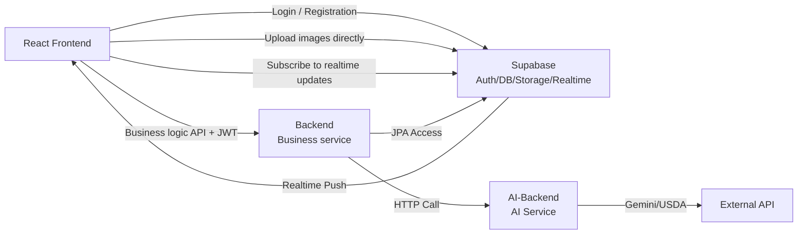

# FoodPrint Backend Design Document

## 1. Project Overview

**FoodPrint** is a food logging and community challenge app that helps users track their diet, receive AI nutrition advice, share in the community, and participate in health challenges.

**Backend architecture:** two independent services run in parallel.
- **backend** (main business service): handles users, food, community, challenges, and other business logic.
- **ai-backend** (dedicated AI service): an independent microservice for food recognition, nutrition analysis, and dietary advice.

**Authentication and database:** fully managed by **Supabase**.
- Supabase Auth: handles login, registration, and password management.
- Supabase PostgreSQL: Stores all business data
- Supabase Storage: Stores images and files

---

## 2. Technology Stack

| Layer | Technology |
|------|------|
| **Language** | Java 17 |
| **Framework** | Spring Boot 3.x |
| **Build** | Maven |
| **Database** | Supabase PostgreSQL |
| **Authentication** | Supabase Auth (JWT) |
| **Storage** | Supabase Storage |
| **Realtime** | Supabase Realtime |
| **Testing** | JUnit 5 + Mockito + H2 |

---

## 3. Overall Architecture



---

## 4. Service Breakdown

### 4.1 Backend(Main business service)

**Responsibilities**
- User data management (profiles and goals)
- Food log CRUD and AI calls
- Community interactions (posts, comments, likes)
- Challenge management (create, join, check in, leaderboard)
- JWT validation (tokens issued by Supabase Auth)
- Supabase database and storage integration

**Key Characteristics**
- Does not implement registration or login; Supabase Auth handles authentication.
- Calls ai-backend over HTTP for AI analysis.
- Stores all data in Supabase PostgreSQL and accesses it through JPA.

### 4.2 AI-Backend(AI Dedicated service)

**Responsibilities** (maintained by the partner team)
- Food image recognition(Gemini)
- Nutrition data lookup(USDA)
- Intent routing and classification
- Dietary advice generation

**Key Characteristics**
- Deployed independently and can scale separately.
- Provides a unified REST API: `POST /api/ai/analyze`
- Communicates with backend only through HTTP.

---

## 5. Data Flow

### 5.1 User Registration / Login (Managed by Supabase)

```
Frontend 
  → supabase.auth.signUp(email, password)
  ← Return JWT token
  → Store the token and attach an Authorization header to subsequent requests.
```

### 5.2 Complete Food Logging Flow

```
1. Frontend uploads an image
   Frontend → supabase.storage.upload(file) 
   ← Return imageUrl (CDN)

2. Request backend food logging
   Frontend → POST /api/food-logs { text, imageUrl, date }
          Header: Authorization: Bearer <jwt>

3. The backend calls AI analysis.
   Backend → POST http://ai-backend/api/ai/analyze 
             { text/imageUrl, userContext }
   ← Return { foods: [...], summary: {...} }

4. Backend saves to the database and returns
   Backend Store in Supabase PostgreSQL
   ← Return to the frontend { id, foods, totalCalories, ... }

5. Realtime push (optional)
   Supabase → Push updates to subscribed frontends (such as leaderboard changes).
```

### 5.3 Community posting

```
Frontend
  → Upload the image to Supabase Storage → Retrieve imageUrl.
  → POST /api/community/posts { title, content, imageUrl }
     Header: Authorization: Bearer <jwt>
  ← Backend Save to Supabase PostgreSQL
     Supabase Realtime Push to other clients
```

---

## 6. Backend Directory Structure

```
backend/
├── pom.xml                             # Maven Dependency configuration
├── src/main/java/com/foodprint/
│   ├── FoodPrintApplication.java       # Spring Boot Entry point
│   │
│   ├── config/                         # Global configuration
│   │   ├── SupabaseConfig.java         # Supabase Connection
│   │   └── SecurityConfig.java         # Spring Security + JWT
│   │
│   ├── security/                       # Security
│   │   ├── JwtAuthenticationFilter.java   # JWT Validation filter
│   │   └── JwtTokenProvider.java          # JWT Utilities
│   │
│   ├── exception/                      # Exception handling
│   │   └── GlobalExceptionHandler.java
│   │
│   ├── middleware/                     # Middleware
│   │   └── LoggingFilter.java
│   │
│   ├── util/                           # Utility classes
│   │   ├── ApiResponse.java            # Unified response format
│   │   └── Constants.java
│   │
│   ├── user/                           # User module
│   │   ├── entity/User.java
│   │   ├── repository/UserRepository.java
│   │   ├── service/UserService.java
│   │   └── controller/UserController.java
│   │
│   ├── food/                           # Food module
│   │   ├── entity/
│   │   │   ├── FoodLog.java
│   │   │   └── NutritionData.java
│   │   ├── repository/
│   │   ├── service/FoodLoggingService.java
│   │   └── controller/FoodController.java
│   │
│   ├── community/                      # Community module
│   │   ├── entity/
│   │   │   ├── Post.java
│   │   │   ├── Comment.java
│   │   │   └── PostLike.java
│   │   ├── repository/
│   │   ├── service/
│   │   └── controller/
│   │
│   ├── challenge/                      # Challenge module
│   │   ├── entity/
│   │   │   ├── Challenge.java
│   │   │   ├── UserChallenge.java
│   │   │   └── ChallengeCheckin.java
│   │   ├── repository/
│   │   ├── service/
│   │   └── controller/
│   │
│   ├── storage/                        # File storage
│   │   └── service/StorageService.java
│   │
│   └── ai/                             # AI client (communicates with ai-backend)
│       ├── dto/
│       │   ├── AIRequest.java
│       │   └── AIResponse.java
│       └── service/AIClient.java
│
├── src/main/resources/
│   ├── application.yml                 # Main configuration (Supabase connection)
│   ├── application-dev.yml
│   ├── application-test.yml
│   └── db/migration/                   # Optional SQL scripts
│
└── src/test/java/com/foodprint/
    ├── FoodPrintApplicationTests.java
    ├── auth/
    ├── food/
    ├── community/
    └── challenge/
```

---

## 7. Engineering Work Allocation

**3 backend engineers (MVP stage)**

| Engineer | Assigned modules | Specific tasks |
|--------|---------|---------|
| **A** | User & Storage | • UserRepository/UserService<br>• User CRUD API<br>• Supabase Storage Upload/Get |
| **B** | Food & AI Call | • FoodLogRepository/Service<br>• Food log API<br>• Call ai-backend<br>• Nutrition aggregation logic |
| **C** | Community & Challenge | • Post/Comment CRUD<br>• Challenge Management<br>• Check-ins and leaderboard<br>• Supabase Realtime Integration |

Shared responsibilities:
- Implement JwtAuthenticationFilter to validate JWTs issued by Supabase.
- Consistent exception handling and error response format
- Write unit tests
- Integration tests with the AI service

---

## 8. Run Guide

### 8.1 Prerequisites

1. Java 17 + Maven
2. Local PostgreSQL (or a Supabase Cloud instance)
3. A Supabase project (obtain URL, AnonKey, and DbPassword)

### 8.2 Configuration

**Environment variables or `application.yml`**

```yaml
spring:
  datasource:
    url: jdbc:postgresql://<project>.supabase.co:5432/postgres
    username: postgres
    password: ${DB_PASSWORD}
  jpa:
    hibernate:
      ddl-auto: validate

supabase:
  url: https://<project>.supabase.co
  anon-key: ${SUPABASE_ANON_KEY}
```

### 8.3 Startup and Testing

```bash
# Build
mvn clean package

# Start
mvn spring-boot:run

# Run tests
mvn test

# Access
curl http://localhost:8080/health
```

---

## 9. API Response Format

All API responses use the following format:

```json
{
  "code": 200,
  "message": "success",
  "data": {}
}
```

Error response:

```json
{
  "code": 400,
  "message": "Invalid request",
  "data": null
}
```

---

## 10. Key Interactions with Supabase

### 10.1 JWT Verify

```java
@Component
public class JwtAuthenticationFilter extends OncePerRequestFilter {
    
    @Value("${supabase.anon-key}")
    private String anonKey;
    
    @Override
    protected void doFilterInternal(HttpServletRequest request,
                                   HttpServletResponse response,
                                   FilterChain chain) throws ServletException, IOException {
        String header = request.getHeader("Authorization");
        if (header != null && header.startsWith("Bearer ")) {
            String token = header.substring(7);
            try {
                // Validate the JWT issued by Supabase
                DecodedJWT jwt = JWT.require(Algorithm.HMAC256(anonKey))
                    .withIssuer("supabase")
                    .build()
                    .verify(token);
                
                String userId = jwt.getSubject();
                // Store in SecurityContext...
            } catch (JWTVerificationException e) {
                response.setStatus(HttpStatus.UNAUTHORIZED.value());
                return;
            }
        }
        chain.doFilter(request, response);
    }
}
```

### 10.2 Database access

Use Spring Data JPA to connect to Supabase PostgreSQL automatically:

```java
@Repository
public interface FoodLogRepository extends JpaRepository<FoodLog, Long> {
    List<FoodLog> findByUserIdAndLogDate(Long userId, LocalDate date);
}
```

### 10.3 Image storage

The frontend uploads directly to Supabase Storage; the backend stores only the returned URL:

```java
// Frontend
const { data, error } = await supabase.storage
    .from('food-images')
    .upload(`${userId}/${timestamp}.jpg`, file);

// Backend receives imageUrl
foodLog.setImageUrl(imageUrl);
```

---

## 11. Development Schedule (One Month)

### Week 1: Framework Setup

- [ ] Initialize the backend project structure.
- [ ] Configure the Supabase connection.
- [ ] Implementation JwtAuthenticationFilter
- [ ] Unit testing framework

### Week 2: Core Feature Development

- [ ] A: User CRUD + Storage Upload
- [ ] B: FoodLog CRUD + AI Call
- [ ] C: Post/Comment CRUD

### Week 3: Advanced Features

- [ ] B: nutrition summaries and weekly reports
- [ ] C: challenge logic and leaderboard
- [ ] Integration tests

### Week 4: Optimization and Launch

- [ ] Performance optimization (indexes and caching)
- [ ] Complete frontend and backend testing
- [ ] Deployment(Docker, CI/CD)
- [ ] Complete documentation

---

## 12. Next Steps

1. **Backend teammates:** implement modules according to the assignments.
2. **Frontend teammates:** integrate Supabase Auth SDK and the Backend API.
3. **AI teammates:** improve ai-backend and provide stable APIs.

Discuss any questions or design updates with the team.

