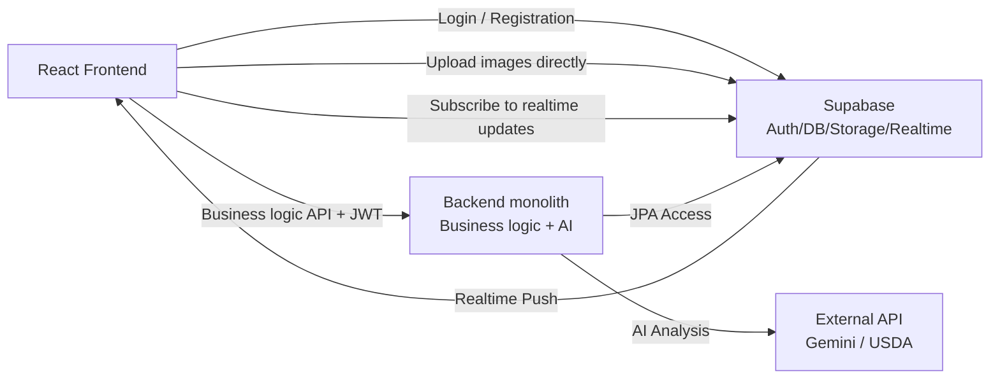
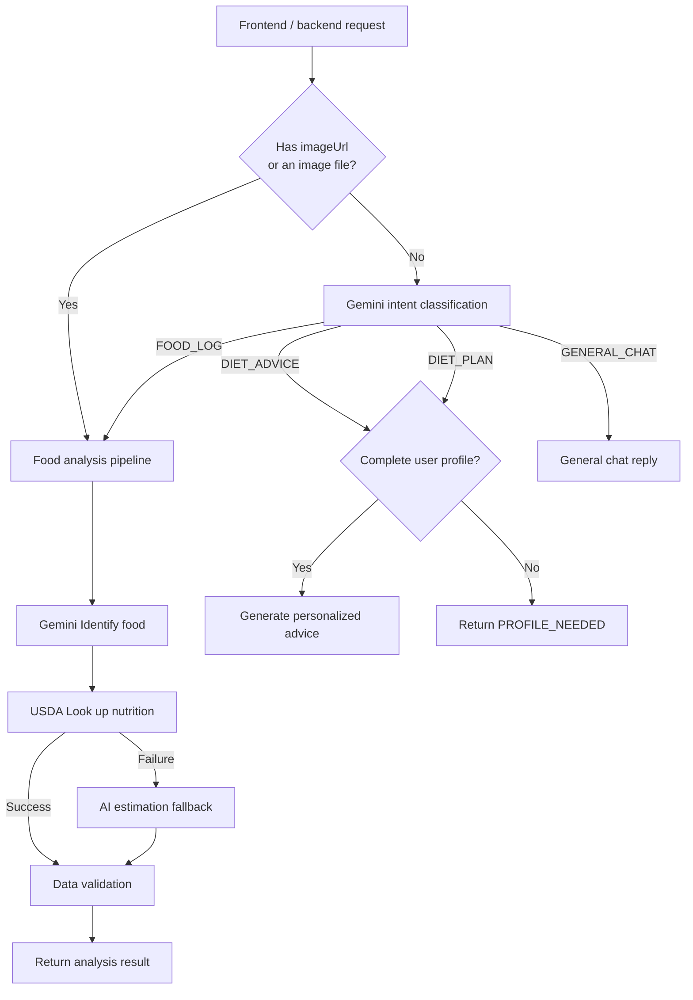
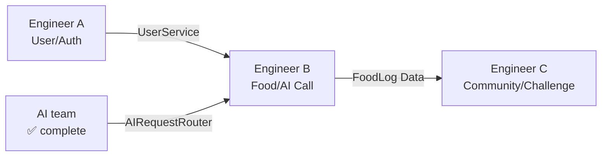

# FoodPrint Backend Design (Including AI Module Integration)

> This document extends `BACKEND_DESIGN.md` and describes the actual architecture, with **the AI module integrated into the backend monolith**.

## 1. Architecture Changes

### Original Design vs. Current Implementation

| Item | Original `BACKEND_DESIGN.md` | Current implementation |
|------|------------------------|----------|
| **AI deployment** | Independent `ai-backend` microservice | Integrated into `backend` under `com.foodprint.ai` |
| **AI usage** | HTTP call to `http://ai-backend/...` | Direct Java injection with `@Autowired AIRequestRouter` |
| **AI Code location** | Separate project | `backend/src/main/java/com/foodprint/ai/*` |
| **Shared DTOs** | Copy classes or share a jar | Direct import; no synchronization needed |

### Why keep a monolith?

MVP Splitting into microservices at this stage adds unnecessary complexity:
- Two deployment configurations and two CI/CD pipelines
- DTO Synchronization maintenance overhead
- Local development requires both services to run
- Inter-service HTTP calls add latency and failure points.

**Current approach:** AI code lives in `com.foodprint.ai`, preserving module boundaries through package isolation. It can be extracted into an independent service as traffic grows.

---

## 2. Overall Architecture



---

## 3. Project Directory Structure

```
backend/src/main/java/com/foodprint/
├── FoodPrintApplication.java          # Spring Boot Entry point
│
├── ai/                                ← AI module (✅ complete)
│   ├── config/
│   │   ├── AIConfig.java              # Gemini/USDA API Configuration
│   │   └── WebClientConfig.java       # HTTP Client Bean
│   ├── controller/
│   │   └── AIController.java          # /api/ai/* REST Endpoint
│   ├── dto/
│   │   ├── AIResponse.java            # Unified AI response
│   │   ├── FoodAnalysisResult.java    # Food analysis result
│   │   ├── FoodIdentificationResult.java
│   │   ├── NutritionData.java         # Nutrition data
│   │   └── UserNutritionContext.java  # User dietary context
│   ├── exception/
│   │   └── AIServiceException.java
│   └── service/
│       ├── AIRequestRouter.java       # Routing core (entry point)
│       ├── GeminiService.java         # Gemini API Call
│       ├── FoodAnalysisService.java   # Food analysis pipeline
│       ├── NutritionLookupService.java # USDA Query + AI fallback
│       ├── NutritionPostProcessor.java # Data validation
│       ├── DietAdviceService.java     # Dietary advice
│       └── UserIntent.java           # Intent enum
│
├── user/                              ← Engineer A(TODO stub)
│   ├── entity/User.java
│   ├── repository/UserRepository.java
│   ├── service/UserService.java
│   └── controller/UserController.java
│
├── food/                              ← Engineer B(TODO stub)
│   ├── entity/FoodLog.java, NutritionData.java
│   ├── repository/FoodLogRepository.java
│   ├── service/FoodLoggingService.java
│   └── controller/FoodController.java
│
├── community/                         ← Engineer C(TODO stub)
│   ├── entity/Post.java, Comment.java, PostLike.java
│   ├── repository/, service/
│   └── controller/CommunityController.java
│
├── challenge/                         ← Engineer C(✅ Completed and aligned with the architecture)
│   ├── entity/Challenge.java, UserChallenge.java, ChallengeCheckin.java
│   ├── repository/, service/
│   └── controller/ChallengeController.java
│
├── config/SecurityConfig.java, SupabaseConfig.java
├── security/JwtAuthenticationFilter.java, JwtTokenProvider.java
├── storage/service/StorageService.java
├── exception/GlobalExceptionHandler.java
├── middleware/LoggingFilter.java
└── util/ApiResponse.java, Constants.java
```

---

## 4. AI Detailed Module Design

### 4.1 Routing Flow



### 4.2 AI Internal Module Call Chain

```
AIController → AIRequestRouter → GeminiService (Intent classification)
                                → FoodAnalysisService → GeminiService (Food identification)
                                                      → NutritionLookupService (USDA)
                                                      → NutritionPostProcessor (Validation)
                                → DietAdviceService → GeminiService (Advice generation)
```

### 4.3 AI API

#### `POST /api/ai/analyze` — Unified Analysis API
**Request body:**
```json
{
  "text": "I had chicken breast and rice for lunch",
  "imageUrl": "https://xxx.supabase.co/storage/v1/food.jpg"
}
```

#### `POST /api/ai/log` — AI Save raw analysis results [NEW]
**Description:** save structured AI analysis data directly as a user Meal Log.
**Request body:**
```json
{
  "title": "My healthy lunch",
  "mealTime": "2024-04-15T12:00:00",
  "imageUrl": "...",
  "analysisResult": { ... }
}
```

#### `POST /api/ai/analyze/image` — Image Upload API
`Content-Type: multipart/form-data`, Field name `image`.

### 4.4 Unified response format

All API responses are wrapped in `ApiResponse<T>`:

```json
{
  "code": 200,
  "message": "success",
  "data": {
    "type": "FOOD_ANALYSIS",
    "foodAnalysis": {
      "foods": [
        {
          "nameEn": "Grilled Chicken Breast",
          "nameZh": "Grilled chicken breast",
          "calories": 165.0,
          "proteinG": 31.0,
          "fatG": 3.6,
          "carbsG": 0.0,
          "fiberG": 0.0,
          "portionAmount": 150.0,
          "portionUnit": "g",
          "dataSource": "USDA"
        }
      ],
      "summary": {
        "totalCalories": 650.0,
        "totalProteinG": 52.0,
        "totalFatG": 18.5,
        "totalCarbsG": 75.0,
        "foodCount": 3
      },
      "confidence": 0.92
    }
  }
}
```

**`data.type` Possible values:**

| type | Description | Key fields |
|------|------|----------|
| `FOOD_ANALYSIS` | Food analysis result | `data.foodAnalysis` |
| `DIET_ADVICE` | Personalized dietary advice | `data.adviceText` |
| `DIET_PLAN` | Meal plan | `data.adviceText` |
| `CHAT` | General chat reply | `data.adviceText` |
| `PROFILE_NEEDED` | Missing user profile | `data.adviceText` |

---

## 5. Data Flow

### 5.1 Complete Food Logging Flow (Updated)

```
1. Frontend uploads an image
   Frontend → supabase.storage.upload(file)
   ← Return imageUrl

2. Frontend calls the backend to log food
   Frontend → POST /api/food-logs { text, imageUrl, date }
   Header: Authorization: Bearer <jwt>

3. The backend calls AI analysis directly in Java, without HTTP.
   FoodLoggingService → aiRouter.routeImageUrl(imageUrl)
   or → aiRouter.routeText(text, userContext)
   ← Return AIResponse { type, foodAnalysis }

4. Backend saves to the database
   FoodLoggingService → FoodLogRepository.save(...)

5. Return to the frontend
   ← { code: 200, data: { id, foods, totalCalories } }
```

### 5.2 Frontend Calls AI Directly (Optional)

The frontend can also call AI endpoints directly, for example to preview analysis results:

```
Frontend → POST /api/ai/analyze { text: "A bowl of rice with eggs" }
← { code: 200, data: { type: "FOOD_ANALYSIS", foodAnalysis: {...} } }
```

---

## 6. Backend Engineer Integration Guide

### 6.1 Engineer B: Food Module Calls AI

```java
@Service
public class FoodLoggingService {

    private final AIRequestRouter aiRouter;  // Inject directly
    private final UserService userService;
    private final FoodLogRepository repo;

    public FoodLog createFoodLog(String text, String imageUrl) {
        UUID userId = getCurrentUserId();
        // 1. Assemble UserNutritionContext
        User user = userService.getUserById(userId);
        UserNutritionContext ctx = new UserNutritionContext();
        ctx.setHeightCm(user.getHeightCm());
        ctx.setWeightKg(user.getWeightKg());
        ctx.setGoal(user.getGoal());
        ctx.setDailyCalorieTarget(user.getDailyCalorieTarget());
        ctx.setTodayCalories(getTodayTotalCalories(userId));
        // ... Other fields

        // 2. Call AI
        AIResponse response;
        if (imageUrl != null) {
            response = aiRouter.routeImageUrl(imageUrl);
        } else {
            response = aiRouter.routeText(text, ctx);
        }

        // 3. Save results to the database
        if ("FOOD_ANALYSIS".equals(response.getType())) {
            FoodAnalysisResult analysis = response.getFoodAnalysis();
            // Map each FoodNutritionDetail to a FoodLog entity
            return saveFoodLog(analysis);
        }
        throw new RuntimeException("Unexpected AI response type: " + response.getType());
    }
}
```

**Required import: **
```java
import com.foodprint.ai.service.AIRequestRouter;
import com.foodprint.ai.dto.AIResponse;
import com.foodprint.ai.dto.UserNutritionContext;
import com.foodprint.ai.dto.FoodAnalysisResult;
```

### 6.2 Engineer A: Provide User Data to AI

AI dietary advice requires a user profile. The `User` entity must contain these fields:

| Field | Type | Description |
|------|------|------|
| height_cm | double | Height (cm) |
| weight_kg | double | Weight (kg) |
| age | int | Age |
| gender | String | Gender |
| goal | String | Goal: LOSE_WEIGHT / MAINTAIN / GAIN_MUSCLE |
| daily_calorie_target | double | Daily calorie target (kcal) |

`UserService` Must provide:
- `getUserById(String userId)` → Return the complete User object.

---

## 7. Frontend Integration Guide

### 7.1 Food Analysis (Photo / Text)

```javascript
// Method 1: text description
const res = await fetch('/api/ai/analyze', {
  method: 'POST',
  headers: {
    'Content-Type': 'application/json',
    'Authorization': `Bearer ${token}`
  },
  body: JSON.stringify({
    text: 'I had chicken breast and rice for lunch'
  })
});
const { code, data } = await res.json();
// data.type === 'FOOD_ANALYSIS'
// data.foodAnalysis.foods → Food list
// data.foodAnalysis.summary.totalCalories → Total calories

// Method 2: image URL (upload to Supabase Storage first)
const { data: upload } = await supabase.storage
  .from('food-images')
  .upload(`${userId}/${Date.now()}.jpg`, file);
const imageUrl = supabase.storage
  .from('food-images')
  .getPublicUrl(upload.path).data.publicUrl;

const res2 = await fetch('/api/ai/analyze', {
  method: 'POST',
  headers: {
    'Content-Type': 'application/json',
    'Authorization': `Bearer ${token}`
  },
  body: JSON.stringify({ imageUrl })
});

// Method 3: upload binary image data directly
const formData = new FormData();
formData.append('image', file);
const res3 = await fetch('/api/ai/analyze/image', {
  method: 'POST',
  headers: { 'Authorization': `Bearer ${token}` },
  body: formData
});
```

### 7.2 Dietary advice

```javascript
const res = await fetch('/api/ai/analyze', {
  method: 'POST',
  headers: {
    'Content-Type': 'application/json',
    'Authorization': `Bearer ${token}`
  },
  body: JSON.stringify({
    text: 'Help me analyze what else I can eat today',
    userContext: {
      heightCm: 175, weightKg: 70,
      age: 25, gender: 'MALE',
      goal: 'LOSE_WEIGHT',
      dailyCalorieTarget: 1800,
      todayCalories: 1200,
      todayProtein: 80, todayFat: 40, todayCarbs: 150
    }
  })
});
const { data } = await res.json();
// data.type === 'DIET_ADVICE'
// data.adviceText → AI Generated advice text
```

### 7.3 Error Handling

```javascript
const { code, message, data } = await res.json();
if (code !== 200) {
  // code === 400 -> invalid request parameters (such as empty text or a non-image file)
  // code === 500 → AI Service error
  showError(message);
}
```

---

## 8. Database Table Design

### users Table(Engineer A)

| Field | Type | Description |
|------|------|------|
| id | UUID (PK) | Supabase Auth uid |
| email | VARCHAR | |
| nickname | VARCHAR | |
| avatar_url | VARCHAR | |
| height_cm | DOUBLE | AI Required |
| weight_kg | DOUBLE | AI Required |
| age | INT | AI Required |
| gender | VARCHAR | AI Required |
| goal | VARCHAR | AI Required |
| daily_calorie_target | DOUBLE | AI Required |
| created_at | TIMESTAMP | |

### food_logs Table(Engineer B)

| Field | Type | Description |
|------|------|------|
| id | BIGINT (PK) | |
| user_id | UUID (FK) | → users.id |
| log_date | DATE | |
| image_url | VARCHAR | |
| original_text | VARCHAR | Original user input |
| ai_confidence | DOUBLE | AI Confidence |
| created_at | TIMESTAMP | |

### food_nutrition_details Table(Engineer B)

| Field | Type | Description |
|------|------|------|
| id | BIGINT (PK) | |
| food_log_id | BIGINT (FK) | → food_logs.id |
| name_en | VARCHAR | English name |
| name_zh | VARCHAR | Food name |
| calories | DOUBLE | |
| protein_g | DOUBLE | |
| fat_g | DOUBLE | |
| carbs_g | DOUBLE | |
| fiber_g | DOUBLE | |
| portion_amount | DOUBLE | |
| portion_unit | VARCHAR | g or ml |
| data_source | VARCHAR | "USDA" or "AI_ESTIMATE" |

---

## 9. Environment Configuration

### 9.1 Required Environment Variables

| Variable | Description | Example |
|------|------|------|
| `GEMINI_API_KEY` | Google Gemini API Key | `AIzaSy...` |
| `USDA_API_KEY` | USDA FoodData Central key (optional; defaults to DEMO_KEY) | `abc123...` |
| `DB_PASSWORD` | Supabase PostgreSQL Password | |
| `SUPABASE_ANON_KEY` | Supabase Anonymous Key | |

### 9.2 Get Gemini API Key

1. Open [Google AI Studio](https://aistudio.google.com/apikey)
2. Click **Create API Key**
3. Select or create a Google Cloud Project
4. Copy the key and set the environment variable: `export GEMINI_API_KEY=AIzaSy...`

### 9.3 Start

```bash
# Set environment variables
export GEMINI_API_KEY=your_key_here

# Build and test
cd backend
mvn clean test                    # Run 41 mock tests
mvn test -Dtest="LiveDemoTest" \
         -Dfoodprint.live=true    # Run live API tests

# Start
mvn spring-boot:run
```

---

## 10. Engineering Work Allocation (Updated)

| Engineer | Assigned modules | Specific tasks | Relationship with AI |
|--------|----------|----------|-------------|
| **AI Team** | `com.foodprint.ai` | ✅ Completed | Provide `AIRequestRouter` |
| **A** | User & Storage & Security | User CRUD, JWT validation, Supabase Storage | Provide `UserService.getUserById()` |
| **B** | Food & AI calls | FoodLog CRUD, AI calls, nutrition aggregation | Assemble `UserNutritionContext` and call `AIRequestRouter` |
| **C** | Community & Challenge | Feed, Challenge, Realtime | ✅ Aligned with the security architecture |

### Dependencies



---

## 11. API Response Format

All APIs use `ApiResponse<T>` consistently:

```json
// Success
{ "code": 200, "message": "success", "data": { ... } }

// Client error
{ "code": 400, "message": "Text and image cannot both be empty", "data": null }

// Server error
{ "code": 500, "message": "Gemini API call failed", "data": null }
```

---

## 12. Testing

| Test class | Coverage | Type |
|--------|----------|------|
| `AIControllerTest` | Controller endpoints | Mock (WebMvcTest) |
| `AIRequestRouterTest` | Routing logic | Mock |
| `FoodAnalysisServiceTest` | Analysis pipeline | Mock |
| `GeminiServiceTest` | Gemini API Call | Mock (MockWebServer) |
| `NutritionLookupServiceTest` | USDA Query | Mock (MockWebServer) |
| `NutritionPostProcessorTest` | Data validation | Isolated unit tests |
| `DietAdviceServiceTest` | Dietary advice | Mock |
| `LiveDemoTest` | Live API end-to-end tests | API key required |

**All 41 mock tests passed.**

```bash
mvn clean test                      # Run mock tests (no API key required)
mvn test -Dtest="LiveDemoTest" \
         -Dfoodprint.live=true      # Run live API tests (key required)
```

---

## 13. Profile Dashboard Views and Advanced Integration API

Based on the concept board requirements, the base modules were extended with three core APIs for the frontend Profile page, each aggregating data from underlying sources.

### 13.1 Global Impact and Achievement Wall (Community Impact)
**Provider:** `CommunityController`
- `GET /api/community/impact-metrics` 
  - **Implementation:** call `UserService` for the total registered user count. Dynamic rules (such as base 850k + N*UserCount) produce the displayed total pounds lost, avoiding a frontend scan of all historical records.

### 13.2 Personal Status Dashboard (User Stats)
**Provider:** `UserController`
- `GET /api/users/me/stats` 
  - **Return DTO: ** `UserStatsResponse` (`achievements`, `goalsMet`, `daysActive`)
  - **Implementation:** `daysActive` queries `FoodLogRepository` to count days with logged records.

### 13.3 Personal Seven-Day Calorie Aggregation (Weekly Overview)
**Provider:** `FoodController`
- `GET /api/food-logs/weekly-overview`
  - **Implementation:** `FoodLoggingService` uses `FoodLogRepository` and `NutritionDataRepository` to **retrieve calorie data persisted from AI analysis**, group and sum it by day, and calculate averages. The frontend can render the `List<DailyCalorie>` DTO with ECharts. Data comes from analysis results already persisted by FoodLogging.


## 14. Decoupled Community Interaction Model (Community Extensibility)

To avoid interfering with the core User data flow, `CommunityController` uses custom cross-table wrappers for complex Feed interactions.

### 14.1 UserFollow (Separate Following Feed)
- **Architecture:** add `com.foodprint.community.entity.UserFollow` within the `community` module to link followers and followed users.
- **Result:** `CommunityService.getFollowingFeed()` uses `UserFollow` to provide a reverse chronological feed containing only creators followed by the current user.

### 14.2 CommunitySubscription (Topics and Micro-communities)
- **Architecture:** introduce `CommunitySubscription` to support the environmentally focused communities requested in the mind map, extending `Community` beyond a single global feed.
- **User experience:** `GET /api/community/my-topics` and `POST /api/community/topics/{name}/join` let users choose topic feeds. The Web frontend can combine these with future Challenge membership data.

## 15. Automated Challenges and Meal Scoring (Automated Evaluation Pipeline)

The **Food** and **Challenge** modules no longer rely on a frontend-supplied UID. They prioritize the security context, consistently with the community module.

### 15.1 Consistent Identity Resolution
- **Mechanism:** `ChallengeService` uses `SecurityContextHolder` to extract the UUID from JWT claims.
- **Security:** `user_challenges.profile_id` is aligned with the actual UID to prevent unauthorized check-ins for other users.

### 15.2 Realtime Nutrition Aggregation
- **Implementation:** `evaluateToday` uses Java Stream processing.
- **Flow:** filter `FoodLog` by date → expand `NutritionData` by foreign key → sum `Double` values.
- **Robustness:** null guards for fields such as `calories` and `protein_g` keep challenge evaluation stable when AI results omit some data.
