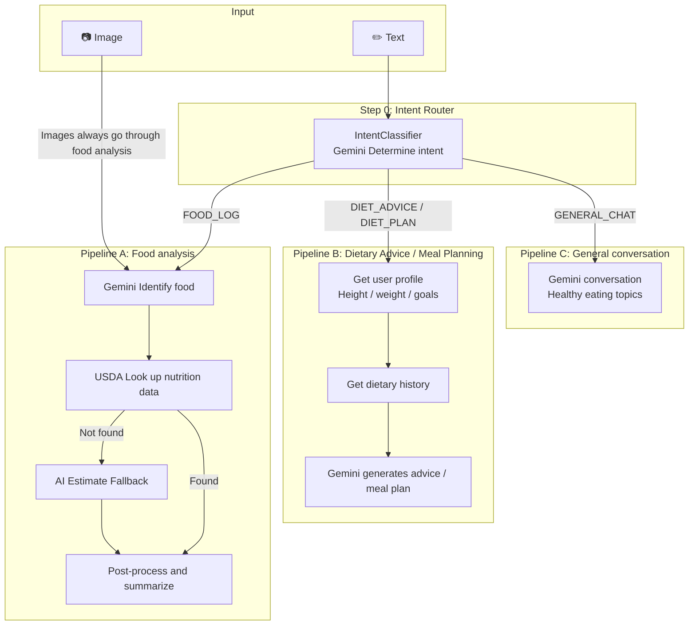
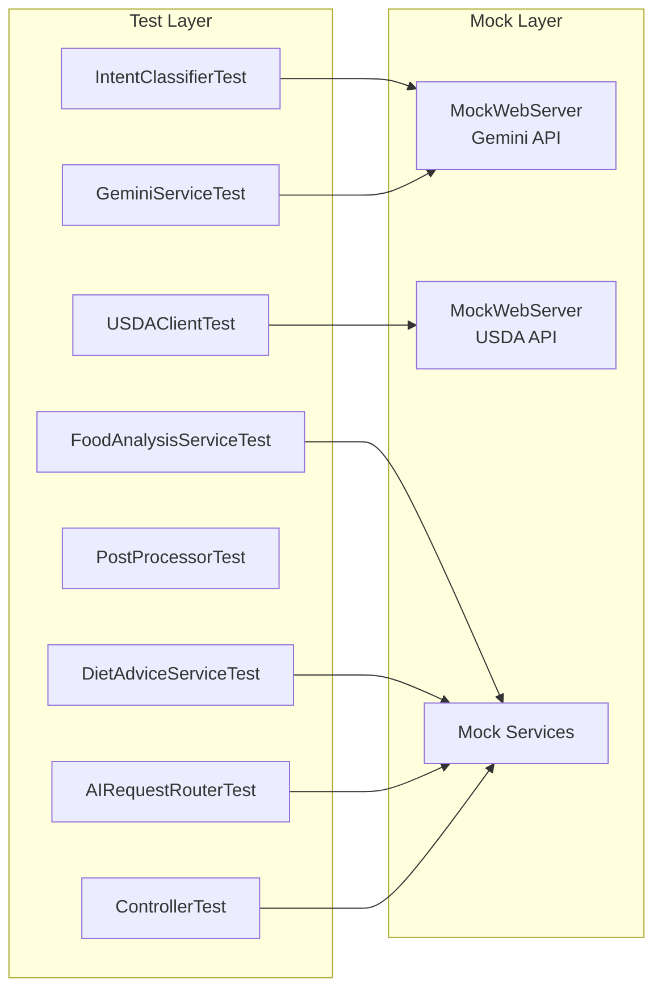

# FoodPrint AI AI Module Design

The AI module receives user input (images or text), **determines intent**, and routes the request through the appropriate processing pipeline.

## Core Issue: Users Do More Than Describe What They Ate

Possible user messages:

| Input type | Example | Processing pipeline |
|---------|------|-------------|
| 📷 Food image | food1.jpg, food2.jpg | → **Food analysis** pipeline |
| ✏️ Description of a meal | "I had chicken breast with rice for lunch" | → **Food analysis** pipeline |
| 🎯 Weight loss / advice | "I want to lose weight. What should I eat?" | → **Dietary advice** pipeline (requires a user profile) |
| 📋 Meal plan request | "Create a one-week fitness meal plan for me" | → **Meal plan** pipeline (requires a user profile and dietary history) |
| 💬 Ambiguous input/Chat | "I am too tired to cook today" | → **General conversation** pipeline |

**Solution: add an Intent Router so Gemini determines what the user wants before selecting a pipeline.**

## Overall Architecture



### Key Design Decisions

> [!IMPORTANT]
> **Image input** goes directly to food analysis, bypassing the Intent Router (taking a photo is treated as food logging).
>
> **Text input** goes through the Intent Router to classify intent before routing.
>
> **Dietary advice and meal plans** require a user profile (height, weight, goals, etc.). If information is missing, return a message asking the frontend to guide profile completion.

## Proposed Changes

All files are located under `backend/src/main/java/com/foodprint/`.

---

### Step 0: Intent Router(New)

#### [NEW] [IntentClassifier.java](file://ai/service/IntentClassifier.java)

```java
public enum UserIntent {
    FOOD_LOG, // "I had ... for lunch" -> food analysis
    DIET_ADVICE, // "What should I eat to lose weight?" -> dietary advice
    DIET_PLAN, // "Create a one-week meal plan" -> meal planning
    GENERAL_CHAT   // "I am tired today" -> general conversation
}

public class IntentClassifier {
    public UserIntent classify(String userMessage);
}
```

Prompt:
```
Classify the user's intent into exactly one category.
User message: "{message}"

Categories:
- FOOD_LOG: User is describing what they ate/are eating
- DIET_ADVICE: User is asking for diet or nutrition advice
- DIET_PLAN: User wants a meal plan or diet schedule
- GENERAL_CHAT: General conversation about food/health

Return ONLY the category name, nothing else.
```

---

### Step 0.5: Request router

#### [NEW] [AIRequestRouter.java](file://ai/service/AIRequestRouter.java)

```java
public class AIRequestRouter {
    public AIResponse route(AIRequest request) {
        // Images go directly to food analysis
        if (request.hasImage()) {
            return foodAnalysisService.analyzeFromImage(request);
        }

        // Classify text intent before routing
        UserIntent intent = intentClassifier.classify(request.getText());

        return switch (intent) {
            case FOOD_LOG    -> foodAnalysisService.analyzeFromText(request);
            case DIET_ADVICE -> dietAdviceService.generateAdvice(request);
            case DIET_PLAN   -> dietAdviceService.generatePlan(request);
            case GENERAL_CHAT -> chatService.chat(request);
        };
    }
}
```

---

### Pipeline A: Food Analysis (Same as the Previous Design)

#### [NEW] [GeminiService.java](file://ai/service/GeminiService.java)

```java
public class GeminiService {
    public FoodIdentificationResult identifyFoodFromImage(byte[] imageData, String mimeType);
    public FoodIdentificationResult identifyFoodFromText(String description);
    public String generateDietAdvice(UserNutritionContext context);
    public UserIntent classifyIntent(String message);
    public String chat(String message, List<ChatMessage> history);
}
```

#### [NEW] [NutritionLookupService.java](file://ai/service/NutritionLookupService.java)

Two-stage fallback: USDA, then AI estimation. (Unchanged from the previous design.)

#### [NEW] [FoodAnalysisService.java](file://ai/service/FoodAnalysisService.java)

Main food analysis flow: Gemini identification, USDA nutrition lookup, then post-processing and aggregation. (Same as before.)

---

### Pipeline B: Dietary Advice / Meal Planning

#### [NEW] [DietAdviceService.java](file://ai/service/DietAdviceService.java)

```java
public class DietAdviceService {
    public DietAdviceResult generateAdvice(AIRequest request) {
        // 1. Get user context from the request (injected by the controller)
        UserNutritionContext ctx = request.getUserContext();

        // 2. Check whether the user profile is complete
        if (ctx == null || !ctx.isProfileComplete()) {
            return DietAdviceResult.profileIncomplete(
                "Your height, weight, and goals are needed to provide advice"
            );
        }

        // 3. Call Gemini to generate advice
        String advice = geminiService.generateDietAdvice(ctx);
        return DietAdviceResult.success(advice);
    }
}
```

**`UserNutritionContext` is supplied by the calling layer; the AI module does not query the database directly:**

```java
public class UserNutritionContext {
    // Basic user information supplied by the user module
    private Double heightCm;
    private Double weightKg;
    private Integer age;
    private String gender;
    private String goal;             // LOSE_WEIGHT / MAINTAIN / GAIN_MUSCLE
    private Integer dailyCalorieTarget;

    // Daily intake supplied by the food record module
    private Double todayCalories;
    private Double todayProtein;
    private Double todayFat;
    private Double todayCarbs;

    // Check whether the profile contains enough information for advice
    public boolean isProfileComplete() {
        return heightCm != null && weightKg != null && goal != null;
    }
}
```

> [!TIP]
> **The AI module does not query the database directly.** The Controller assembles and passes in `UserNutritionContext`, keeping the AI module independent of changes to the user system.

---

### DTOs

#### [NEW] [dto/AIRequest.java](file://ai/dto/AIRequest.java)

```java
public class AIRequest {
    private byte[] imageData;              // Image (optional)
    private String imageMimeType;
    private String text;                   // Text (optional)
    private String mealType;               // BREAKFAST / LUNCH / DINNER / SNACK
    private UserNutritionContext userContext; // User context (injected by Controller)
}
```

#### [NEW] [dto/AIResponse.java](file://ai/dto/AIResponse.java)

```java
public class AIResponse {
    private String type;              // FOOD_ANALYSIS / DIET_ADVICE / DIET_PLAN / CHAT
    private FoodAnalysisResult foodAnalysis;    // type=FOOD_ANALYSIS When
    private DietAdviceResult dietAdvice;        // type=DIET_ADVICE/DIET_PLAN When
    private String chatMessage;                 // type=CHAT When
    private boolean profileIncomplete;          // true = The frontend should guide profile completion
    private String profilePrompt;               // Tell the user which information is missing
}
```

---

### API Controllers

#### [NEW] [AIController.java](file://ai/controller/AIController.java)

| Method | Endpoint | Description |
|--------|----------|------|
| POST | `/api/ai/analyze` | Unified image / text entry point with automatic routing |
| POST | `/api/ai/analyze/image` | Direct image analysis (skip Router) |

---

### Configuration

#### [NEW] [application.yml](file://resources/application.yml)

```yaml
foodprint:
  ai:
    gemini:
      api-key: ${GEMINI_API_KEY:YOUR_GEMINI_API_KEY}
      model: gemini-2.0-flash
    usda:
      api-key: ${USDA_API_KEY:DEMO_KEY}
      base-url: https://api.nal.usda.gov/fdc/v1
```

---

## Post-processing Logic

```java
public class NutritionPostProcessor {
    // 1. Range validation: a single food item should not exceed 2000 calories
    // 2. Consistency validation: calories ≈ protein*4 + fat*9 + carbs*4
    // 3. Normalize portions to grams
    // 4. Flag outliers: ask the user to confirm if confidence < 0.5
}
```

## Verification Plan — Fully Isolated Tests

All tests mock external dependencies and require no network, database, or other modules.

### Test Architecture



### Test Case List

#### 0. `IntentClassifierTest` — Intent classification

| Case | Input | Expected intent |
|------|------|------------|
| Description of a meal | "I had chicken breast with rice for lunch" | `FOOD_LOG` |
| English food description | Contents of demo_text1.txt | `FOOD_LOG` |
| Request for weight loss advice | "What should I eat to lose weight" | `DIET_ADVICE` |
| Request for a meal plan | "Create a one-week fat loss meal plan for me" | `DIET_PLAN` |
| Casual chat | "I am too tired to cook today" | `GENERAL_CHAT` |

#### 1. `GeminiServiceTest` — AI Call

| Case | Input | Mock Response | Verify |
|------|------|-----------|------|
| Successful image recognition | food1.jpg bytes | Preset JSON | Return udon + tomato + cucumber |
| Successful text recognition | demo_text1.txt | Preset JSON | Parse 5 food items |
| Invalid AI JSON response | - | `{invalid}` | Throw a custom exception |
| AI Timeout | - | Delay 10s | Timeout exception |

#### 2. `NutritionLookupServiceTest` — USDA + Fallback

| Case | Input | Mock Response | Verify |
|------|------|-----------|------|
| USDA lookup succeeds | `"chicken breast"` | Normal result | `source=USDA` |
| No USDA results | `"unknown xyz"` | Empty | Fall back to AI, `source=AI_ESTIMATE` |
| USDA unavailable | Any | HTTP 500 | Fall back to AI without crashing |
| Portion conversion | 150g chicken | per-100g Data | Scale values correctly |

#### 3. `FoodAnalysisServiceTest` — Complete pipeline

| Case | Scenario | Verify |
|------|------|------|
| Single food in an image | 1 food item | Result includes a nutrition summary |
| Multiple foods in text | 3 food items | `MealSummary` totals equal the sum of items |
| No input | Empty | Invalid parameter |

#### 4. `DietAdviceServiceTest` — Dietary advice

| Case | UserContext | Verify |
|------|------------|------|
| Complete profile | Height 170 / weight 70 / fat loss goal | Return advice text |
| Incomplete profile | Height and weight missing | `profileIncomplete=true` |
| Null context | null | `profileIncomplete=true` |

#### 5. `AIRequestRouterTest` — Request routing

| Case | Input | Verify |
|------|------|------|
| Image present | Image bytes | Go directly to FoodAnalysis without classification |
| Text FOOD_LOG | Mock intent=FOOD_LOG | Use FoodAnalysis |
| Text DIET_ADVICE | Mock intent=DIET_ADVICE | Use DietAdvice |
| Text GENERAL_CHAT | Mock intent=GENERAL_CHAT | Use Chat |

#### 6. `AIControllerTest` — API Endpoint

| Case | Request | Verify |
|------|------|------|
| Upload image | POST multipart | 200 + FOOD_ANALYSIS |
| Text analysis | POST JSON text | 200 + Return based on intent |
| Empty request | POST Empty body | 400 |

### Test Data

`src/test/resources/testdata/`(Provided by the user):
- `food1.jpg` — udon noodles, tomatoes, and cucumber soup
- `food2.jpg` — steak, mushrooms, and garlic
- `demo_text1.txt` — detailed English food description (5 food items)
- `demo_text2.txt` — Simple English food description

Additional mock data (generated during development):
- `gemini_response_food1.json` / `gemini_response_food2.json`
- `gemini_response_text1.json` / `gemini_response_text2.json`
- `usda_response_chicken.json` / `usda_response_rice.json`

```bash
cd backend
./mvnw test -Dtest="com.foodprint.service.ai.**,com.foodprint.controller.AI*"
```
