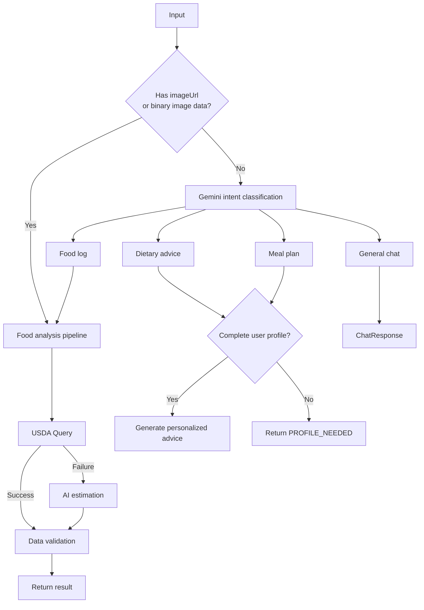

# AI Module Walkthrough

## 1. Module Status

| Item | Status |
|------|------|
| Food image analysis | ✅ Complete |
| Food text analysis | ✅ Complete |
| Intent routing | ✅ Complete |
| USDA Nutrition lookup + AI Fallback | ✅ Complete |
| Dietary advice/Plan | ✅ Complete |
| General chat | ✅ Complete |
| imageUrl API | ✅ Complete |
| Unified ApiResponse Format | ✅ Complete |
| Unit tests (41/41) | ✅ All passed |

## 2. Package Structure

```
com.foodprint.ai/
├── config/
│   ├── AIConfig.java          # Gemini/USDA API Configuration
│   └── WebClientConfig.java   # HTTP Client bean
├── controller/
│   └── AIController.java      # REST Endpoint
├── dto/
│   ├── AIResponse.java        # Unified AI response
│   ├── FoodAnalysisResult.java
│   ├── FoodIdentificationResult.java
│   ├── NutritionData.java
│   └── UserNutritionContext.java
├── exception/
│   └── AIServiceException.java
└── service/
    ├── AIRequestRouter.java       # Routing core
    ├── GeminiService.java         # Gemini API Call
    ├── FoodAnalysisService.java   # Analysis pipeline
    ├── NutritionLookupService.java # USDA + AI fallback
    ├── NutritionPostProcessor.java # Data validation
    ├── DietAdviceService.java     # Dietary advice
    └── UserIntent.java            # Intent enum
```

## 3. Routing Rules



## 4. API Endpoint

### `POST /api/ai/analyze`

**Request body:**

| Field | Type | Required | Description |
|------|------|------|------|
| `text` | String | One of the two | User input text |
| `imageUrl` | String | One of the two | Image URL (higher priority) |
| `userContext` | Object | No | User information (for dietary advice) |

**Response:**
```json
{ "code": 200, "message": "success", "data": { "type": "...", ... } }
```

`data.type` Possible values: `FOOD_ANALYSIS`, `DIET_ADVICE`, `DIET_PLAN`, `CHAT`, `PROFILE_NEEDED`

### `POST /api/ai/analyze/image`

Upload binary image data using `Content-Type: multipart/form-data` and the field name `image`.

---

## 5. Engineer B Integration Guide (Food Logging Module)

### Usage

```java
// Inject the AI module directly into FoodLoggingService
@Service
public class FoodLoggingService {

    private final AIRequestRouter aiRouter;
    private final UserService userService;

    // Create a food log
    public FoodLog createFoodLog(String userId, String text, String imageUrl) {
        // 1. Assemble user context
        User user = userService.getUserById(userId);
        UserNutritionContext ctx = new UserNutritionContext();
        ctx.setHeightCm(user.getHeightCm());
        ctx.setWeightKg(user.getWeightKg());
        ctx.setGoal(user.getGoal());
        ctx.setDailyCalorieTarget(user.getDailyCalorieTarget());
        ctx.setTodayCalories(getTodayTotalCalories(userId));

        // 2. Call AI directly in Java, without HTTP
        AIResponse response;
        if (imageUrl != null) {
            response = aiRouter.routeImageUrl(imageUrl);
        } else {
            response = aiRouter.routeText(text, ctx);
        }

        // 3. Save results
        if ("FOOD_ANALYSIS".equals(response.getType())) {
            return saveFoodLog(userId, response.getFoodAnalysis());
        }
        return null;
    }
}
```

### Required import

```java
import com.foodprint.ai.service.AIRequestRouter;
import com.foodprint.ai.dto.AIResponse;
import com.foodprint.ai.dto.UserNutritionContext;
```

### Notes

- `imageUrl` takes priority over `text`; the AI module automatically downloads and analyzes the image.
- `userContext` may be null, but dietary advice requires it.
- AI errors use `AIServiceException`; catch it and return a user-friendly error.

---

## 6. Database Team Integration Guide

### AI User fields required by the module

| Field | Type | Description |
|------|------|------|
| height_cm | double | Height |
| weight_kg | double | Weight |
| age | int | Age |
| gender | String | Gender |
| goal | String | Goal (LOSE_WEIGHT/MAINTAIN/GAIN_MUSCLE) |
| daily_calorie_target | double | Daily calorie target |

### AI Analysis result fields to store(per food item)

| Field | Type | Description |
|------|------|------|
| name_en | String | English food name |
| name_zh | String | Chinese food name |
| calories | double | Calories |
| protein_g | double | Protein |
| fat_g | double | Fat |
| carbs_g | double | Carbohydrates |
| fiber_g | double | Fiber |
| data_source | String | "USDA" or "AI_ESTIMATE" |
| portion_amount | double | Portion value |
| portion_unit | String | Portion unit |

---

## 7. TODO

| Priority | Task | Owner |
|--------|------|------|
| P0 | Integrate Supabase PostgreSQL | Engineer A |
| P0 | Implement JWT validation | Engineer A |
| P0 | Food log CRUD and AI calls | Engineer B |
| P1 | Multi-turn conversation context management | AI Module + Frontend |
| P1 | AI Roast Feature | AI Module |
| P2 | Add retries (Resilience4j) | AI Module |
| P2 | Cache popular foods (Redis) | AI Module |
| P2 | Move API keys to environment variables | Shared |
| P3 | Streaming output (SSE/WebSocket) | AI Module |
